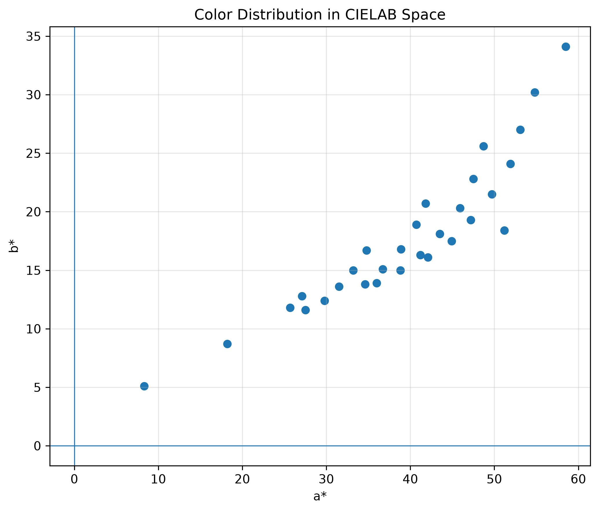
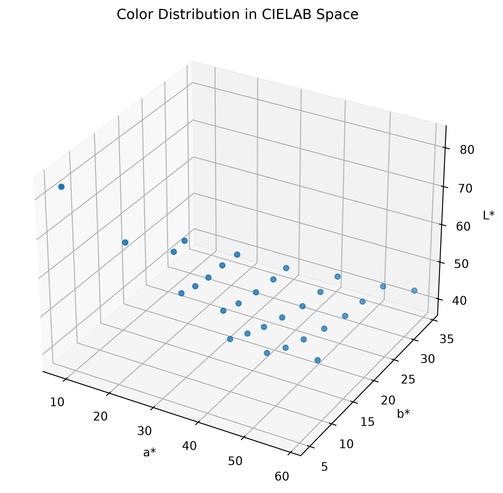
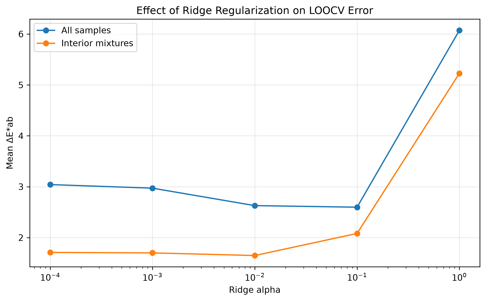
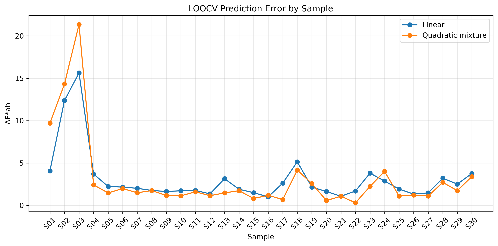

# Color Dispersions Color Prediction

A proof-of-concept project for predicting CIELAB color values from color dispersion mixture compositions using regression models.

## Overview

This project explores whether CIELAB color coordinates (L*, a*, b*) can be predicted from the mixing ratios of three color dispersions.

The project focuses on applying regression techniques to a mixture system and evaluating prediction performance using color difference (ΔE).

## Dataset

A synthetic dataset containing 30 mixture compositions was created for this demonstration.

Each sample contains:

- Mixing ratios of three color dispersions (A, B, and C)
- CIELAB color coordinates (L*, a*, b*)

The mixture compositions satisfy:

A + B + C = 1

Synthetic data are used to avoid disclosure of proprietary experimental data.

## Color Distribution

The synthetic samples were visualized in CIELAB color space to examine the distribution of the dataset.

### a*-b* Color Distribution

### 3D CIELAB Distribution

## Methods

The following models were evaluated:

- Linear regression
- Quadratic mixture regression
- Ridge-regularized quadratic mixture regression

The quadratic mixture model includes interaction terms:

AB, AC, and BC

Model performance was evaluated using leave-one-out cross-validation (LOOCV), which is suitable for evaluating models with a small dataset.

Color prediction error was quantified using ΔE*ab (CIE76).

## Results

For interior mixture compositions, LOOCV produced the following results:

| Model | Mean ΔE | Median ΔE | Max ΔE |
|---|---:|---:|---:|
| Linear regression | 2.259 | 1.916 | 5.139 |
| Quadratic mixture model | 1.709 | 1.466 | 4.159 |

The quadratic mixture model reduced the mean ΔE by approximately 24% compared with the linear model within the interpolation region.

## Ridge Regularization

Ridge regression was applied to the quadratic mixture model to investigate whether regularization could improve prediction stability.

Several regularization strengths were evaluated using LOOCV.

| Alpha | Mean ΔE | Median ΔE | Max ΔE | Interior Mean ΔE |
|---:|---:|---:|---:|---:|
| 0.0001 | 3.042 | 1.541 | 21.162 | 1.708 |
| 0.001 | 2.971 | 1.536 | 19.691 | 1.699 |
| 0.01 | 2.628 | 1.433 | 13.643 | 1.647 |
| 0.1 | 2.597 | 1.982 | 11.940 | 2.081 |
| 1.0 | 6.073 | 5.257 | 17.479 | 5.228 |

Moderate regularization improved the stability of the quadratic mixture model. In this synthetic dataset, α = 0.01 provided a good balance between reducing large endpoint errors and maintaining prediction accuracy within the interior mixture region.

Stronger regularization reduced the worst-case error further at α = 0.1, but increased prediction error within the interior region. At α = 1.0, overall performance deteriorated substantially.

## Error Analysis

The largest LOOCV errors occurred for pure-component samples.

When a pure-component endpoint was left out during cross-validation, the model had to predict outside the composition range represented in the remaining training data.

This suggests that prediction reliability depends not only on model complexity, but also on whether the target composition lies within the experimental design space.

The three pure-component samples (S01–S03) showed substantially larger prediction errors than the interior mixture samples. When these endpoints were left out during LOOCV, prediction required extrapolation beyond the composition range represented in the remaining training data.

## Limitations

- The dataset used in this repository is synthetic.
- The dataset is relatively small.
- ΔE*ab (CIE76) is used as a simple color-difference metric.
- Performance on synthetic data should not be interpreted as real-world predictive accuracy.

## Project Structure

    data/
        synthetic_data.csv
        README.md

    src/
    data_validation.py
    visualization.py
    linear_model.py
    quadratic_model.py
    ridge_model.py
    model_evaluation.py
